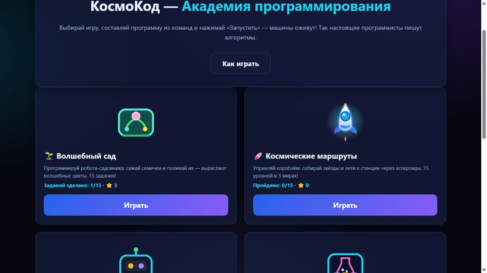
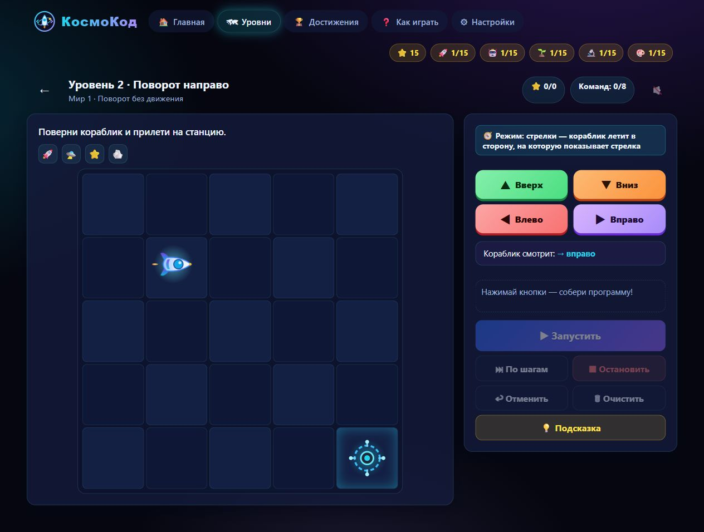
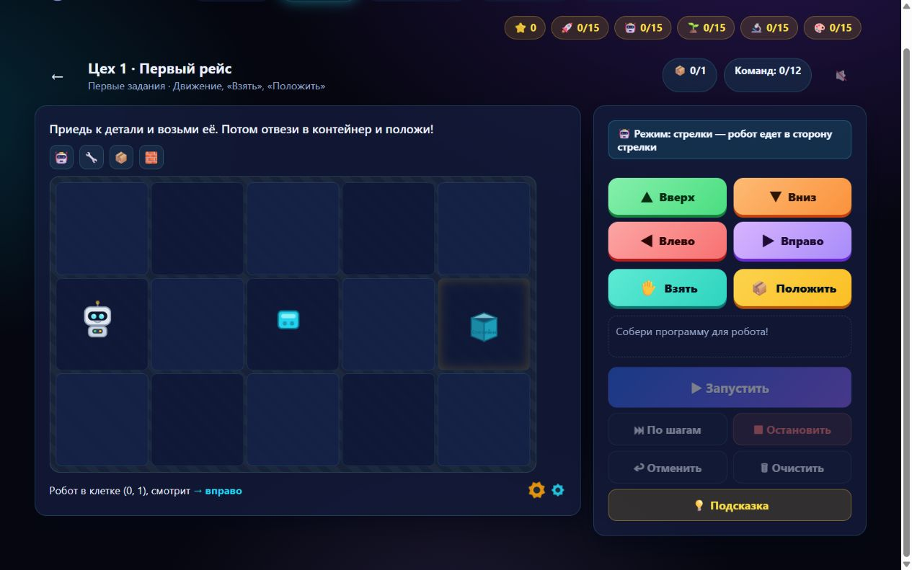
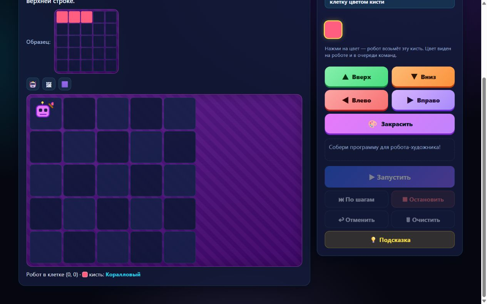
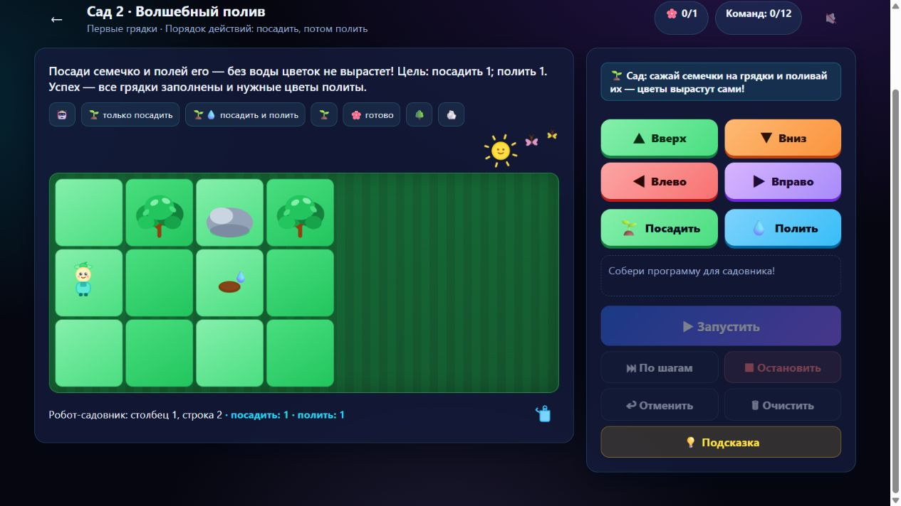
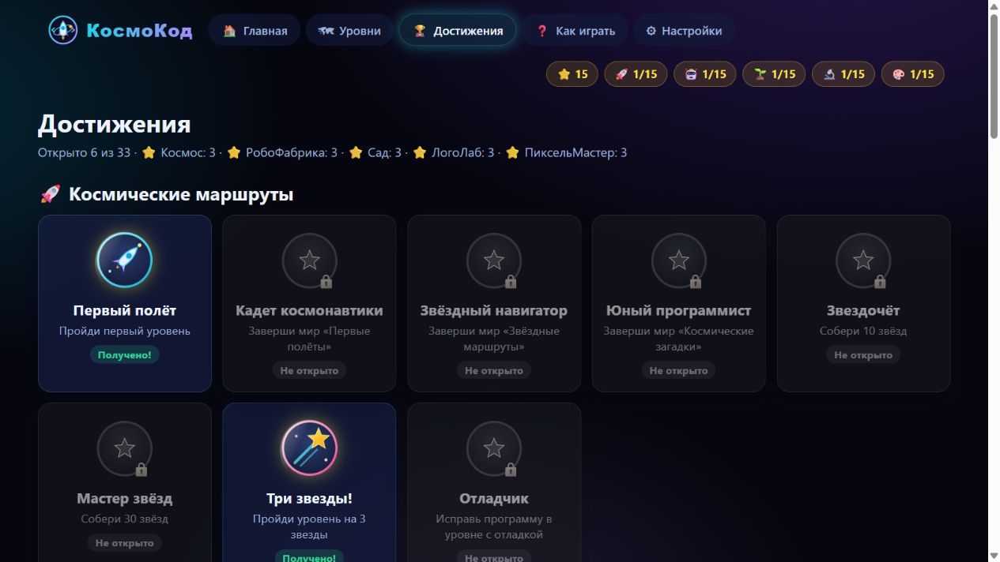

# КосмоКод — Академия программирования

  

<strong>Пять игровых миров. 75 уровней. Первые шаги в алгоритмах — через игру.</strong>

<a href="https://github.com/vika-penchuk-dev/KosmoKod/releases/tag/v1.0.0"><strong>📥 Скачать КосмоКод для Android</strong></a>

Образовательная игра для детей 6–13 лет: ребенок собирает программу из команд и наблюдает, как она оживает на игровом поле.

---

## О проекте

«КосмоКод» — самостоятельная игровая академия программирования. Вместо абстрактных задач здесь пять знакомых игровых сюжетов: космическое путешествие, работа робота на фабрике, волшебный сад, логические лаборатории и пиксельное рисование.

Игрок составляет последовательность команд, запускает ее, проверяет результат и учится исправлять ошибки. В некоторых заданиях ПиксельМастера доступны циклы «Повторить N раз».

## Пять игровых миров

| Мир | Чему учит | Уровни |
| --- | --- | ---: |
| 🚀 **Космические маршруты** | Строить маршрут, учитывать направление и собирать звезды | 15 |
| 🤖 **РобоФабрика** | Планировать движение, брать и сортировать детали | 15 |
| 🌱 **Волшебный сад** | Составлять последовательность действий для посадки и полива | 15 |
| 🔬 **ЛогоЛаб** | Решать задачи на порядок действий и логические маршруты | 15 |
| 🎨 **ПиксельМастер** | Рисовать по клеткам, выбирать цвет и применять циклы | 15 |
| **Всего** | **75 уровней в пяти мирах** | **75** |

## Возможности

- Программирование командами движения и действий.
- Циклы в заданиях ПиксельМастера.
- 33 достижения и система звезд за прохождение.
- Необязательные звуковые эффекты и русская озвучка команд.
- Локальное сохранение прогресса и настроек на устройстве.
- Офлайн-работа: установленная Android-версия не требует подключения для игры; веб-версия сохраняет оболочку после первой успешной загрузки. Доступность сетевой обработки речи зависит от выбранного системного голосового движка.
- Подсказки и пошаговая проверка программы.

## Галерея

  

<em>Пять игровых миров на главной странице.</em>

| Космический маршрут | РобоФабрика |
| --- | --- |
|  |  |

| ПиксельМастер | Волшебный сад |
| --- | --- |
|  |  |

  

<em>Достижения пяти игровых миров.</em>

Снимки сделаны из актуальной версии проекта. Исходные изображения и логотип подготовлены в рамках разработки КосмоКода; сведения об авторстве и сторонних компонентах собраны в [уведомлениях](THIRD_PARTY_NOTICES.md).

## Установка на Android

Первый релиз: **v1.0.0, сборка 2**. Поддерживаются устройства с **Android 8.0 (API 26) и новее**.

1. Скачайте [`KosmoKod-v1.0.0-build2.apk`](https://github.com/vika-penchuk-dev/KosmoKod/releases/tag/v1.0.0) со страницы релиза.
2. Откройте загруженный APK. Если Android попросит разрешение на установку приложений из этого источника, разрешите его для браузера или файлового менеджера и повторите установку.
3. После установки запустите «КосмоКод» с экрана приложений.

APK сборки 2 опубликован в GitHub Releases и не хранится среди обычных файлов репозитория.

## Технологии

- **React 19** и **TypeScript** — интерфейс и игровая логика.
- **Vite 7** — веб-сборка.
- **Capacitor 8** и Android SDK — Android-приложение.
- **CSS, SVG, Web Audio API, Web Speech API, `localStorage`, Service Worker** — оформление, графика, звук, озвучка, локальные сохранения и офлайн-оболочка.

## Первый релиз

**КосмоКод v1.0.0, build 2** — первый релиз проекта: пять игровых миров, 75 уровней и 33 достижения. APK сборки 2 доступен на странице релиза v1.0.0.

## Автор и связь

**Виктория Пенчук** · © 2026

Вопросы о проекте и лицензии: [myklodvp@gmail.com](mailto:myklodvp@gmail.com).

## Лицензия и документы

Оригинальные компоненты КосмоКода распространяются по авторской [лицензии КосмоКода](LICENSE-KOSMOKOD.md); проект не публикуется как MIT. Условия использования и политика конфиденциальности доступны в [документах](docs/legal/). Лицензии библиотек и уведомления о сторонних компонентах приведены в [THIRD_PARTY_NOTICES.md](THIRD_PARTY_NOTICES.md).

© 2026 Виктория Пенчук. Все права защищены в пределах, указанных в авторской лицензии и применимом законодательстве.
